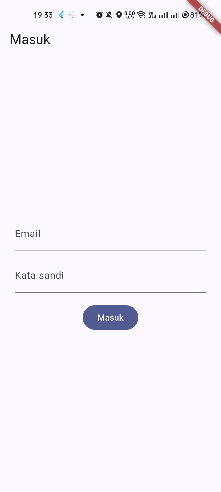

# Minggu 7: Clean Architecture (Feature-First) — Campus Notify

Dokumentasi implementasi dan refactoring aplikasi **Campus Notify** menggunakan pendekatan **Clean Architecture** berbasis modul per fitur (*feature-first*). Proyek ini memisahkan logika bisnis, antarmuka pengguna, dan akses data secara ketat sesuai prinsip SOLID, khususnya *Dependency Inversion Principle* (DIP).

---

## Daftar Isi
1. [Tujuan](#1-tujuan)
2. [Diagram Layer dan Arah Dependensi](#2-diagram-layer-dan-arah-dependensi)
3. [Fitur Utama](#3-fitur-utama)
4. [Stack Teknologi](#4-stack-teknologi)
5. [Struktur Folder](#5-struktur-folder)
6. [Cara Menjalankan](#6-cara-menjalankan)
7. [Hasil yang Dicapai](#7-hasil-yang-dicapai)

---

## 1. Tujuan

Praktikum dan tugas pada Minggu 7 ini berfokus pada refactoring arsitektur aplikasi mobile agar memenuhi standar enterprise dan mudah dipelihara:

- **Separation of Concerns (SoC):** Memisahkan tanggung jawab kode ke dalam tiga lapisan terisolasi: **Domain**, **Data**, dan **Presentation**.
- **Struktur Feature-First:** Mengorganisir kode per fitur (`features/auth`, `features/announcements`, `features/notes`) sehingga setiap modul memiliki lapisan domain, data, dan presentation masing-masing.
- **Penerapan Dependency Inversion Principle (DIP):** Lapisan domain mendefinisikan kontrak/antarmuka abstraksi (*repository interface*), sedangkan lapisan data mengimplementasikannya. Lapisan tingkat tinggi tidak bergantung pada modul tingkat rendah; keduanya bergantung pada abstraksi.
- **Sterilitas Lapisan Domain:** Menjamin lapisan domain 100% murni Dart, bebas dari dependensi framework (`flutter`, `dio`, `sqflite`, `firebase`).
- **Sterilitas Lapisan Presentation:** Menjamin UI widget tidak melakukan panggilan data mentah (seperti `Dio`, database SQLite, atau `FlutterSecureStorage`) maupun instansiasi manual kelas repositori.
- **Peningkatan Testability:** Mempermudah pengujian unit murni (*pure unit tests*) pada Use Cases tanpa memerlukan mock framework yang berat atau ketergantungan pada runtime Flutter.

---

## 2. Diagram Layer dan Arah Dependensi

### 2.1 Konsep Dependency Inversion & Dependency Rule
Aturan fundamental dalam Clean Architecture adalah **Dependency Rule**: *Kode di lapisan luar hanya boleh bergantung pada lapisan di dalamnya, dan lapisan dalam tidak pernah mengetahui lapisan luar.*

```mermaid
flowchart TD
    subgraph PresentationLayer["Presentation Layer (Outer)"]
        UI["Widgets / Pages (Login, Home, Detail)"]
        Providers["Riverpod Providers (DI & Notifiers)"]
    end

    subgraph DomainLayer["Domain Layer (Core Center - Pure Dart)"]
        Entities["Entities (Business Models)"]
        UseCases["Use Cases (Business Logic & Validation)"]
        RepoContract["Repository Interfaces (Contracts)"]
        Failures["Failures (Sealed Classes)"]
    end

    subgraph DataLayer["Data Layer (Outer)"]
        RepoImpl["Repository Implementations"]
        Models["Data Models (JSON/Map Serialization)"]
        DataSources["Data Sources (Dio, Secure Storage, FCM)"]
    end

    %% Dependency Arrows
    UI --> Providers
    Providers -->|memanggil| UseCases
    UseCases -->|bergantung pada abstraksi| RepoContract
    RepoImpl -.->|mengimplementasikan (DIP)| RepoContract
    Models -.->|mewarisi / memetakan ke| Entities
    RepoImpl --> Models
    RepoImpl --> DataSources

    classDef presentation fill:#e1f5fe,stroke:#0288d1,stroke-width:2px,color:#01579b;
    classDef domain fill:#e8f8f5,stroke:#26a69a,stroke-width:3px,color:#004d40;
    classDef data fill:#fff3e0,stroke:#f57c00,stroke-width:2px,color:#e65100;

    class UI,Providers presentation;
    class Entities,UseCases,RepoContract,Failures domain;
    class RepoImpl,Models,DataSources data;
```

### 2.2 Diagram Aliran Kontrol vs Arah Dependensi

```
┌─────────────────────────────────────────────────────────────────────────────┐
│                            PRESENTATION LAYER                               │
│                   [Login Page / Home Page] (UI Widget)                      │
│                                     │                                       │
│                                     │ memanggil                             │
│                                     ▼                                       │
│                         [StateNotifier / Provider]                          │
└─────────────────────────────────────┬───────────────────────────────────────┘
                                      │ (arah dependensi mengarah ke dalam)
                                      ▼
┌─────────────────────────────────────────────────────────────────────────────┐
│                               DOMAIN LAYER                                  │
│                             [LoginUseCase]                                  │
│                                     │                                       │
│                                     │ memanggil interface                   │
│                                     ▼                                       │
│                        <<interface>> AuthRepository                         │
└─────────────────────────────────────▲───────────────────────────────────────┘
                                      │ (Dependency Inversion: Impl mengarah ke Domain)
                                      │
┌─────────────────────────────────────┴───────────────────────────────────────┐
│                                DATA LAYER                                   │
│                            AuthRepositoryImpl                               │
│                                     │                                       │
│                        mengakses sumber data mentah                         │
│                                     ▼                                       │
│                    [Dio Client / FlutterSecureStorage]                      │
└─────────────────────────────────────────────────────────────────────────────┘
```

> **Catatan Dependensi:**
> Aliran kendali (*flow of control*) berjalan dari Presentation $\to$ Domain $\to$ Data, namun arah dependensi (*flow of dependency*) dibalik menggunakan *interface*, sehingga Presentation dan Data sama-sama bergantung pada Domain.

---

## 3. Fitur Utama

### 1. Autentikasi & Pengelolaan Sesi (`features/auth`)
- **Login Pengguna:** Dilengkapi validasi aturan bisnis di Domain Layer (`LoginUseCase`), seperti pengecekan format email yang valid dan panjang minimal kata sandi sebelum permintaan dikirim ke repository.
- **Penyimpanan Token Aman:** `AuthRepositoryImpl` menggunakan `FlutterSecureStorage` untuk menyimpan sesi dan token autentikasi.
- **Logout:** Menghapus data sesi lokal dan membersihkan status autentikasi di antarmuka.
- **Auto-Restore Sesi:** Aplikasi otomatis memulihkan sesi pengguna yang masih valid saat diluncurkan kembali.

### 2. Pengumuman Kampus (`features/announcements`)
- **Daftar Pengumuman Kampus:** Menampilkan pengumuman penting akademik dengan status visual (loading, data kosong, atau error) menggunakan Riverpod `FutureProvider`.
- **Detail Pengumuman:** Navigasi ke rute `/announcements/:id` untuk menampilkan rincian pengumuman yang dipilih.
- **Validasi Domain ID:** `GetAnnouncementDetail` use case menolak ID kosong dengan mengembalikan `ValidationFailure`.
- **Ekstraksi Utilitas Format Murni:** Fungsi pemformatan tanggal (`formatDateTime`, `formatDateOnly`) dan validasi parser ID pengumuman dipisahkan ke `core/format.dart` tanpa ketergantungan pada Flutter UI.

### 3. Modul Notes (`features/notes`)
- Implementasi contoh modul catatan sesuai jobsheet praktikum yang menerapkan kontrak `NoteRepository`, entitas murni `Note`, dan use case `GetNotes` untuk membuktikan kemudahan unit testing dengan *fake repository*.

### 4. Push Notification & Deep Linking (`messaging`)
- Integrasi **Firebase Cloud Messaging (FCM)** untuk penerimaan pesan notifikasi background dan terminated.
- **Flutter Local Notifications** untuk menampilkan heads-up notification saat aplikasi berada di latar depan (*foreground*).
- Penanganan deep-link interaktif: menekan notifikasi langsung mengarahkan pengguna ke halaman detail pengumuman terkait.

### 5. Type-Safe Error Handling dengan Dart 3 Records
- Menggantikan exception mentah atau library pihak ketiga (`fpdart`/`dartz`) dengan fitur bawaan Dart 3 Records:
  ```dart
  Future<({T? result, Failure? failure})>
  ```
- Failure dimodelkan sebagai *sealed class* (`AuthFailure`, `NetworkFailure`, `ServerFailure`, `ValidationFailure`, `LocalFailure`), menjamin seluruh kemungkinan error tertangani secara komprehensif di presentation layer.

---

## 4. Stack Teknologi

| Kategori | Teknologi / Pustaka | Versi | Fungsi / Peran |
|---|---|---|---|
| **Core Framework** | Flutter / Dart SDK | `^3.13.5` | Framework pengembangan aplikasi mobile cross-platform |
| **State Management & DI** | `flutter_riverpod` | `^3.4.3` | Pengelolaan state reaktif dan dependency injection terpusat |
| **Routing & Navigation** | `go_router` | `^18.0.2` | Navigasi deklaratif dan dukungan deep linking rute |
| **HTTP Client** | `dio` | `^5.11.1` | Komunikasi REST API dan penanganan jaringan |
| **Secure Storage** | `flutter_secure_storage`| `^11.2.0` | Penyimpanan token sesi secara aman terenkripsi |
| **Push Notification** | `firebase_core`<br>`firebase_messaging` | `^4.15.0`<br>`^16.7.0` | Integrasi infrastruktur Firebase Cloud Messaging (FCM) |
| **Local Notification** | `flutter_local_notifications` | `^22.3.1` | Penanganan notifikasi lokal dan banner foreground |
| **Icons** | `cupertino_icons` | `^1.0.8` | Asset icon antarmuka bergaya iOS/Material |
| **Testing & Quality** | `flutter_test`<br>`flutter_lints` | `SDK`<br>`^6.0.0` | Unit testing, widget testing, dan static analysis linter |

---

## 5. Struktur Folder

Aplikasi diatur menggunakan paradigma **Feature-First**:

```text
campus_notify/
├── lib/
│   ├── core/                                # Komponen bersama lintas fitur
│   │   ├── failures.dart                    # Hierarchy Failure (sealed class murni Dart)
│   │   └── format.dart                      # Fungsi murni format tanggal & parse rute
│   ├── features/                            # Modul per fitur (Clean Architecture)
│   │   ├── auth/                            # Fitur Autentikasi
│   │   │   ├── domain/                      # Lapisan Domain (Steril dari Flutter)
│   │   │   │   ├── entities/                # AuthSessionEntity
│   │   │   │   ├── repositories/            # AuthRepository (Kontrak interface)
│   │   │   │   └── usecases/                # Login, Logout, GetSavedSession
│   │   │   ├── data/                        # Lapisan Data
│   │   │   │   ├── models/                  # AuthSessionModel (mapping JSON/Map)
│   │   │   │   └── repositories/            # AuthRepositoryImpl (Dio + Storage)
│   │   │   └── presentation/                # Lapisan Antarmuka
│   │   │       ├── pages/                   # LoginPage
│   │   │       └── providers/               # DI Provider & AuthNotifier
│   │   ├── announcements/                   # Fitur Pengumuman
│   │   │   ├── domain/
│   │   │   │   ├── entities/                # Announcement entity
│   │   │   │   ├── repositories/            # AnnouncementRepository interface
│   │   │   │   └── usecases/                # GetAnnouncements, GetAnnouncementDetail
│   │   │   ├── data/
│   │   │   │   ├── models/                  # AnnouncementModel
│   │   │   │   └── repositories/            # AnnouncementRepositoryImpl
│   │   │   └── presentation/
│   │   │       ├── pages/                   # HomePage, AnnouncementPage
│   │   │       └── providers/               # announcementsProvider, DI
│   │   └── notes/                           # Fitur Catatan (Contoh Jobsheet)
│   │       ├── domain/
│   │       │   ├── entities/                # Note entity
│   │       │   ├── repositories/            # NoteRepository interface
│   │       │   └── usecases/                # GetNotes use case
│   │       └── data/
│   │           └── models/                  # NoteModel
│   ├── messaging/
│   │   └── push_service.dart                # Push notification service infrastructure
│   ├── routes.dart                          # Konfigurasi rute GoRouter & redirection
│   └── main.dart                            # Titik masuk aplikasi & ProviderScope
└── test/                                    # Unit dan Widget Testing
    ├── announcements_usecase_test.dart
    ├── auth_push_test.dart
    ├── auth_usecase_test.dart
    ├── format_test.dart
    ├── get_notes_test.dart
    └── widget_test.dart
```

---

## 6. Cara Menjalankan

### 6.1 Prasyarat
- Flutter SDK (versi $\ge$ 3.13.5).
- Emulator Android / iOS atau perangkat fisik yang terhubung via USB debugging.

### 6.2 Langkah Instalasi & Menjalankan

1. Masuk ke direktori aplikasi `campus_notify`:
   ```bash
   cd campus_notify
   ```

2. Unduh seluruh dependensi yang diperlukan:
   ```bash
   flutter pub get
   ```

3. Jalankan analisis statis untuk memastikan kode bebas kesalahan linter:
   ```bash
   flutter analyze
   ```

4. Jalankan seluruh unit test dan widget test:
   ```bash
   flutter test
   ```

5. Jalankan aplikasi pada perangkat/emulator:
   ```bash
   flutter run
   ```

### 6.3 Verifikasi Sterilitas Arsitektur (Dependency Audit)

Untuk memverifikasi bahwa aturan dependensi Clean Architecture ditaati tanpa kebocoran:

- **Audit Domain Layer** (harus 0 dependensi framework):
  ```bash
  grep -rE "package:flutter/|package:dio|package:sqflite|package:firebase" lib/features/*/domain lib/core
  ```
- **Audit Presentation Layer** (harus 0 panggilan data mentah langsung):
  ```bash
  grep -rE "Dio\(|openDatabase|getDatabasesPath|FlutterSecureStorage|SharedPreferences\.getInstance|jsonDecode" lib/features/*/presentation lib/pages
  ```
- **Audit Kebocoran DI di Presentation** (harus 0 inisialisasi repositori konkret):
  ```bash
  grep -rE "Repository\(|Dio\(BaseOptions" lib/features/*/presentation lib/pages
  ```

---

## 7. Hasil yang Dicapai

### 7.1 Hasil Uji Analisis & Testing Otomatis

Seluruh pengujian otomatis dan analisis kode berhasil dijalankan dengan hasil sempurna:

- **Static Analysis (`flutter analyze`):**
  ```text
  Analyzing campus_notify...
  No issues found! (ran in 5.2s)
  ```

- **Suite Pengujian (`flutter test` — 20 Tests Passed):**
  ```text
  00:02 +20: All tests passed!
  ```
  Rincian pengujian yang lulus:
  - `test/auth_usecase_test.dart`: Validasi email, validasi panjang kata sandi, proses login sukses mengembalikan entitas, dan proses logout.
  - `test/announcements_usecase_test.dart`: Pengambilan daftar pengumuman, pengambilan detail berdasarkan ID, dan penolakan ID kosong dengan `ValidationFailure`.
  - `test/get_notes_test.dart`: Penerusan data dan kegagalan pada `GetNotes` tanpa unhandled exception.
  - `test/format_test.dart`: Pemformatan tanggal/waktu dan validasi integer ID pengumuman.
  - `test/widget_test.dart`: Render halaman detail pengumuman pada widget tree.
  - `test/auth_push_test.dart`: Pengujian routing, status token, dan penanganan HTTP 401/timeout.

### 7.2 Verifikasi Sterilitas Dependensi

| Kriteria Audit | Target Direktori | Hasil Verifikasi |
|---|---|:---:|
| Lapisan **Domain** bebas framework | `lib/features/*/domain`, `lib/core` | **0 Pelanggaran (Bersih)** |
| Lapisan **Presentation** bebas akses data mentah | `lib/features/*/presentation` | **0 Pelanggaran (Bersih)** |
| Tidak ada inisialisasi repositori manual di Presentation | `lib/features/*/presentation` | **0 Pelanggaran (Bersih)** |

### 7.3 Tangkapan Layar Aplikasi

Berikut adalah hasil antarmuka aplikasi **Campus Notify** setelah refactoring:

| Halaman Login | Halaman Utama (Daftar Pengumuman & FCM) |
|:---:|:---:|
|  |  |

| Pengujian Notifikasi Lokal (Foreground) | Detail Pengumuman #1 | Detail Pengumuman #7 |
|:---:|:---:|:---:|
|  |  |  |

---

## Dokumen Terkait
- [Catatan Lengkap Refactoring Campus Notify](campus_notify/README.md)
- [Dokumentasi Keputusan Arsitektur & AI Challenge](docs/ai_challenge.md)
